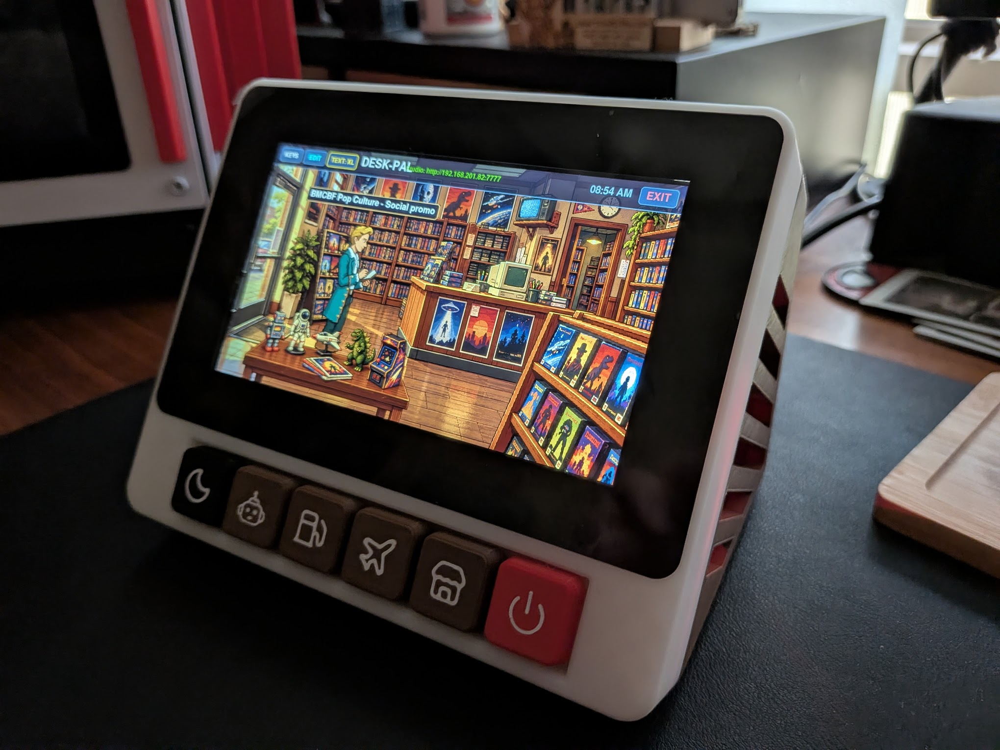

# Desk-Pal

Desk-Pal is a small animated application monitor for a Raspberry Pi and touchscreen. A character walks between scenes and performs gestures to show what other applications are doing, whether they are healthy, and whether something needs your attention.

**The character does not perform the work.** Separate applications do the work and send status or events; Desk-Pal maps those inputs to animations, scene locations, props and optional messages.

The hardware targets Raspberry Pi 4 or newer, the official 5-inch Raspberry Pi Touch Display 2 and six Cherry MX-style mechanical buttons. The current personal build runs on a Pi 4. Its pixel-art scenes are a study, video store, resort beach and apartment. This is a working personal project; installation scripts and some adapters still reflect that installation rather than a finished portable distribution.



The assembled personal build, displaying an application event in the video-store scene.

## How it fits together

```text
External applications / separate monitors
             │ JSON heartbeats and named events
             ▼
       Desk-Pal on the Pi
       ├─ received state and health checks
       ├─ event → scene / animation / location mappings
       ├─ queued character reactions and idle behaviour
       └─ touchscreen, physical buttons and browser editor
```

Applications can push events directly or be polled directly by Desk-Pal's native background poller. They can run on the same Pi or elsewhere. Importing an integration definition adds configuration; it does not install or launch the external application.

## Open and use the editor

For a new PC installation without anyone else's backup or applications, start with [Fresh setup](docs/fresh-setup.md). It includes generic scene/character content and an example integration.

For a separate Raspberry Pi setup, see [Portable Pi installation](docs/pi-installation.md). Its generated paths are tested locally; fresh-Pi hardware verification is still pending.

For a separate PC installation with the real renderer playing inside the browser editor, see [Local installation and Live preview](docs/local-preview.md). It uses its own settings/assets and simulated events, with GPIO and physical power controls disabled.

To run Desk-Pal as an interactive resizable PC companion window (without needing the Pi screen or browser preview), see [Desktop Companion Mode](docs/desktop-companion.md). Launch it directly with `python scripts/run_desktop.py --size 960x540` or `.\scripts\start_desktop.ps1`.

Open `http://YOUR-PI:7777/` from a browser on the local network. The display's scene canvas is 1280×720; the physical display may scale it. Most setup happens visually in Web Studio:

- **Scene selector:** above the scene image.
- **Pose Stager:** place and preview character animations.
- **Foreground objects:** trace the artwork that can cover the character.
- **Limits:** calibrate near/far character size against the walkable floor.
- **View props:** place animated props separately from character animations.
- **Interactive Props & Mini-Games:** tap screen props to launch overlays like CRT TV channel viewers or mini-games (e.g. Breakout Arcade on the study computer). See [Interactive Mini-Games](docs/mini-games.md).
- **Block / Entry–Exit / Scene map:** edit floor obstructions, paths and scene connections.
- **Animation Grid:** characters, frames, sequences and generation references.
- **App & Action Studio:** integration connections, event mappings, physical buttons and idle/sleep eligibility.
- **Companion Scripts:** deploy, manage, and edit lightweight on-Pi Python microservices, APIs, and scrapers with live log streaming and 1-click Desk-Pal app linking.
- **Save to Pi:** persist changes. Some panels also have a specific save button; use it after editing their settings.

Pi network reachability notifications are configured with **Pi health** above the scene. See [Connectivity health](docs/system-health.md) for alert modes, recovery behaviour and checks.

On the touchscreen, swipe down from the top edge to reveal Keys, Edit, text size and the editor address. The Keys toggle lets you cycle on-screen quick button indicators between Always Show (`always`), Always Hide (`never`), or Show when Pressed (`on_press`, auto-dismisses after 2.5s, default), which is also configurable in Web Studio header or via hotkey `s`. The clock and Exit remain visible over the scene; scene-specific day/night header colours are set in **Scene backgrounds**. Editor overlays start unchecked so the scene is initially unobstructed.

Check the editor's save confirmation before leaving a panel. Changes to a producer's polling configuration and changes to a character animation are separate settings.

## Characters and animations

1. Open **Animation Grid**, choose a character, or use **Add** to create a new character ID.
2. Use **Upload reference** for the character's appearance reference. Use **Upload frames**, or tag existing sprites for that character.
3. Choose an animation role and arrange its frames in the timeline. Preview it, check alignment and colours, and set its FPS.
4. Choose playback: **once**, **repeat a set number of times**, **loop**, or **ping-pong**. Save the sequence.
5. Place the animation in each relevant scene using **Pose Stager** and **Save position**. Add another location explicitly when the same gesture belongs in several places.

The selected character determines which sprite sequences are used. Pose locations belong to their scene; the same animation can have different locations in different scenes. An `*` in the stager's pose selector indicates a saved location in the current scene.

A placement can override the animation's playback without changing every other placement. Angled seated placements can have vector offsets for foreground layering. Walking sequences are handled by movement rather than listed as ordinary staged gestures. Sitting/lying poses require their entry and get-up transitions; transition-only sequences are not regular idle/event choices.

The sleeping Z particles are a renderer effect tied to the lying-down `sleeping` animation. They follow the frame skeleton's head and mirror with it; they are not yet a selectable prop/effect for other resting placements.

### Generate additional frames

Correct the animation's wireframes, then use **Download reference: this animation** or **all animations**. These guides pair the character reference with pose skeletons and instructions for generating new artwork. They do not include existing animation sprites as the requested new frames.

Generate candidate frames externally, then upload and assemble them in the grid. Keep the same character proportions, clothing colours, scale and image alignment across frames. Inspect the loop before using it in a scene. The legacy `scripts/sprite_forge.py` can slice and align generated frame sheets; it is a separate preparation tool.

Character deletion asks for confirmation. Review that confirmation carefully: it removes character configuration and sequences/tags, while image files and skeleton guides are retained.

## Scenes, floors and foreground objects

Use **Scene map → Add a scene** to create a scene from a landscape PNG/JPEG. Select that scene in the regular editor before editing its geometry and placements. Scenes can be disabled while retaining their data and connections.

- Draw the **walkable floor polygon** on the ground. Floor points remain within the image; selecting a point provides removal controls.
- Add **blocks** around objects' ground footprints, not around their whole visible silhouette. These prevent walking and ordinary pose placement through the object.
- Use **Foreground objects** to trace the visible parts that should cover a character walking behind them. Depth comes from the ground footprint. A foreground outline and a floor block serve different purposes.
- Split an object into suitable masks when necessary. A deck chair's backrest and seat need different occlusion for a seated character; placement-specific vector offsets can resolve angled layering.
- Place gestures with **Pose Stager**. Multiple locations are visible/selectable, with controls to save, remove a pose or delete a location.
- Add entry/exit points and their inside path endpoints. In **Scene map**, drag connections between points on scene previews. Connections can be removed, and **Edit scene** opens the regular editor for path changes.

Props have their own animation library and scene placements. They can be positioned, scaled and rotated, previewed during placement, and associated with relevant actions. Foreground masks, blocks and props should be checked together on the actual small display.

Props can be added with your own images and animation frames, then placed and linked to character actions. Some scenes already contain tappable Easter egg interactions. Interactive props can open an overlay while monitoring continues and attention remains waiting afterward. See [Image props](docs/image-props.md) and [Custom interactive props](docs/interactive-tv.md).

Use **Go to scene on Pi** beside the editor scene dropdown to send the character to the selected saved scene through its linked exits. Save new scenes and connections first.

All four scenes follow a shared day/night cycle with smooth dawn/dusk lighting. Open **Day / night settings** beside the scene selector to set latitude, longitude and an IANA timezone (for example `Australia/Brisbane`, `Europe/London` or `America/New_York`). It calculates approximate sunrise/sunset for that location and shows today's times when saved. Named timezones follow daylight saving automatically; leaving timezone blank uses the Pi's system timezone. Defaults are Brisbane coordinates. These settings are shared across all scenes (`lighting.latitude`, `lighting.longitude`, `lighting.timezone`). Use **Scene backgrounds** to upload separate day/night artwork, and **Preview: Day / Night** to check it in the editor. Scenes without night artwork use derived lighting. Prop placements can be visible during the day, at night or both, including the built-in typing monitor. See [Day/night authoring](docs/day-night-authoring.md). Display standby remains a separate power-off feature.

## Add an application integration

Start with [Adding integrations](docs/adding-integrations.md), [example definition](examples/integration.example.json) and [example sender](examples/send_example.py).

For the application-side interface, follow the [worked producer example](docs/producer-interface-example.md), with [cached status/button JSON](examples/status.example.json) and a [completed-job payload](examples/job-finished.example.json). It explains how to expose real dated results without repeating old data as new activity. The [BMCBF consumer notes](docs/bmcbf-interface-notes.md) document the existing adapter and missing information.

In **App & Action Studio → Add application**, enter an application or import its JSON integration file. Then configure:

1. **Connection:** direct HTTP polling or push events, polling interval, freshness warning and normal-update reaction.
2. **Events & mappings:** select an event, choose a scene visually, then a gesture and a specific location or any matching placement. Conditions can select reactions from payload values.
3. **Physical button:** assign an available button and its cached-status response.

A heartbeat means the monitor checked in; a named event means a task, order or other occurrence happened. Producers should provide stable occurrence IDs/timestamps so successive real tasks are distinguishable even when their results are identical.

**Suppress successive duplicates** avoids replaying unchanged event values. **Suppress event entirely** skips its reactions while retaining incoming state, counts, health and configuration; it also removes matching queued/active work. These are independent options. Save event settings after changing them. Physical button requests remain usable when automatic heartbeat reactions are suppressed.

Application reactions normally play in arrival order, including travel and transitions. Button actions interrupt feed playback and take priority; button popups stay until dismissed by touch or the same button. Finite sequences follow their configured playback. A loop duration of `0` means no override: an unrestricted loop continues until another event arrives, then yields at a cycle boundary. Positive durations limit looping playback. Queue status distinguishes this waiting loop from an animation awaiting acknowledgement or popup dismissal.

Attention events can keep their mapped gesture active until you tap the character or press the matching application button. This opens the associated information popup, which remains until dismissed. Ordinary button requests still use their normal mapped response.

Routine reactions can accumulate if incoming events arrive faster than travel/playback finishes. The current personal configuration suppresses heartbeat animations to observe genuine events; this does not stop monitoring. While asleep, routine updates coalesce to the latest per app/event, and old routine updates expire on wake (default 15 minutes, configurable per application). Important events remain queued. Awake routine coalescing remains a follow-up.

Use **Unused animations & idle** to find unmapped placements and select animations eligible for idle behaviour or the sleep button. Checkbox changes save immediately. Animations already mapped to application events or buttons are excluded from idle, across all scenes. Idle advances through eligible unmapped poses across connected enabled scenes after application work finishes, then waits for the next event. Looping poses continue; once/repeat poses hold their final frame. The sleep button advances the same cycle across connected enabled scenes to the next reachable sleep-enabled placement, performs its entry transition, and powers off the display after settling. Wake performs the get-up transition before queued work resumes.

### Independent monitors in this installation

The personal BMCBF, Fuel and Travel adapters are optional; they are not required for generic integrations. Desk-Pal polls HTTP status endpoints directly over the local network via its native poller.

The [separate store monitor](integrations/store-monitor/README.md) runs as its own Pi service with its own setup page, credentials, logs and polling. Etsy authorization/automatic token refresh and a separate Big Cartel personal-authentication/OAuth order adapter are implemented. Orders poll at least every 15 minutes and totals hourly; Desk-Pal buttons use cached values. The Stores button reports active orders from connected stores, with paid/unshipped/non-canceled filtering for Etsy. Both stores are connected in the personal installation; dashboard count validation and a genuine new-order test remain pending. Etsy message monitoring is deferred. The monitor directory is standalone and can be moved into its own repository.

### Built-in Companion Services & Scripts

For custom Python scripts, scrapers, or lightweight microservices you want running directly on the Raspberry Pi (without needing an external PC or manual SSH/systemd configuration), Desk-Pal includes a built-in **Companion Services Supervisor** (`src/companion_supervisor.py`).

Open **⚡ Companion Scripts** in Web Studio to:
- Create, edit, and run local Python scripts on the Pi.
- Monitor live console logs streamed in real time.
- Start with pre-built templates (Simple JSON API, Flight Radar API, Webhook Relay).
- Automatically link scripts to Desk-Pal's Application list (`config.apps`) with local loopback status endpoints.
- Safeguard background processes with rate-limited auto-restart and clean shutdown on exit.

See [Companion Services & Scripts](docs/companion-services.md) for architecture, manifest schema, and status API contracts.

## Optional: LLM agent activity through MCP

Desk-Pal's main purpose remains application monitoring. As a separate optional extension, an LLM agent can report meaningful task phases, completion or a request for your attention, and have those reports displayed using the existing scene mappings and queue.

The agent and its tools run elsewhere. The character represents what the agent reports; it does not execute the task, inspect the model's reasoning or independently verify its progress. Desk-Pal needs no LLM, AI subscription or MCP dependency for its normal operation. Nothing is enabled automatically, and the standard application setup is unchanged.

See [Optional agent activity: purpose and limits](docs/agent-activity.md) for the distinction, and the [separate MCP adapter setup guide](integrations/agent-mcp/README.md) when you want to connect an agent. A display tap acknowledges a notification; answers and authorization stay in the agent's own interface.

## AI Models & Speech (External Downloads)

Desk-Pal supports on-device speech synthesis, wake word transcription, and tool calling. To keep the repository lightweight and adhere to open model distribution licenses, **no heavy model weights or audio binaries are bundled in this repository**.

* **Piper TTS (Speech Synthesis)**:
  * Recommended voice models: low or medium quality models (e.g. en_US-lessac-low or en_GB-alan-low) which provide crisp speech on Raspberry Pi 4 CPU with minimal RAM overhead (~180 MB).
  * Download models via the Web Studio interface (**AI & Speech → Add voice**) or manually download the .onnx and .onnx.json pairs from the official [HuggingFace Piper Voices repository](https://huggingface.co/rhasspy/piper-voices) and place them in ~/.cache/deskpal/piper/<voice-id>/.
  * See the [Piper TTS Guide](integrations/piper-tts/README.md) for detailed setup.

* **Cactus Compute (On-Device Tool Calling & Whistle STT)**:
  * Powered by cactus-needle for structured natural language action routing.
  * Install the package in the Python environment: pip install cactus-needle.
  * Runtime models are fetched and cached automatically by the library from [Cactus Compute](https://cactuscompute.com).

* **faster-whisper (Voice Sentry STT)**:
  * Uses the ultra-compact 	iny.en model running on CPU via CTranslate2.
  * Model weights are downloaded automatically on first run and cached in ~/.cache/huggingface/hub/.

## Hardware and enclosure

See [Hardware, wiring and printed parts](docs/hardware.md) for the six-button wiring and enclosure. The [Hardware live view and calibration guide](docs/hardware-testing.md) covers optional sensors and audio checks.

Open **Hardware** in the editor or `http://YOUR-PI:7777/hardware`. Enable devices independently:

| Optional hardware | Available features |
| --- | --- |
| BH1750 light sensor | Live lux, dark-triggered rest/screen-off, bright wake, a manual-wake grace period and sunset-to-bedtime keep-awake window and optional fresh-radar presence override |
| MPU6050 accelerometer/gyroscope | Live 3D orientation, hands-free graphical calibration for angled mounts, neutral offsets and gyro bias |
| RD-03D radar | Target plot/trails, raw values, presentation averaging and automatic guided movement capture |
| Physical buttons | Configurable BCM GPIO assignments and live test mode that suppresses button actions |
| Speaker / USB microphone | Saved USB / 3.5mm / system-default speaker output, saved volume slider, short beep and bounded microphone level tests; no recording or voice service |

Guided IMU calibration learns the fixed mounting angle from opposite movement pairs, rather than requiring the sensor axes to line up with the case. It asks for one movement per direction and detects return to the starting tilt before advancing. Captures are retained for review, including failed attempts. Recalibrate after changing the mount. Radar capture is diagnostic: current housed distance/position accuracy remains unverified, and visual smoothing does not calibrate the sensor.

**App & Action Studio → Sensors** maps mild/strong tilt, shake and optional person-returned events to animations at the character's current position or a saved placement. Current-position tilt/shake briefly interrupts ordinary movement, then resumes its route. Two four-frame balance reactions have reviewed skeletons and generation instructions in both reference export modes. An optional morning radar greeting can wake after sleep once per local morning before a cutoff, with date and the latest cached fuel price. See [Sensor reactions](docs/sensor-triggers.md).

Hardware preferences/calibration remain separate in `hardware_settings.json`; keep a private copy because ordinary portable content backups do not yet include them. USB speaker output has been physically confirmed. Fully supported normal desktop operation remains roadmap work.

The hardware guide includes the [complete enclosure model](https://makerworld.com/en/models/2418768-case-for-raspberry-pi-5-touch-display-2-w-buttons#profileId-2652559), [tolerance-adjustable keycap generator](https://makerworld.com/en/makerlab/community/keycap-legend/edit), eight-position harness orientation and soldering/ground distribution details. This build used low-profile generated keycaps. The builder also provides [sensor mounts for the BH1750, MPU-6050 and RD-03D](https://makerworld.com/en/models/3423200-rpi-5-touch-case-h1750-mpu-6050-rd-03d-mounts). These holders keep the sensors secure while allowing them to slide out for disassembly. Model credits/licences and detailed print settings can be completed from the source pages.

## Running and maintaining the project

The Pi renderer is `src/deskpal_app.py`, using Pygame, the standard-library HTTP server and optional `gpiozero`/`lgpio` inputs. It needs a working graphical session; GPIO and display-power support depend on the installed Pi hardware/OS. The browser editor is served by that application on port 7777, not by a separate FastAPI service.

Runtime Python console logs rotate near 1 MB with three older files; event history and derived image caches are also bounded. A read-only asset/temporary-file report identifies missing references and review candidates without deleting artwork or backups. See [Maintenance](docs/maintenance.md).

The existing Pi installation uses `/home/admin` for deployed modules/assets/configuration. Keep its scene configuration when deploying code changes. `scripts/deploy_guarded_files.py` verifies source baselines and backs up configuration; inspect and adapt its installation-specific connection settings before use. Some older deployment helpers also upload configuration and can overwrite live edits.

Repository layout:

| Directory | Purpose |
| --- | --- |
| `src/` | Renderer, editor, scene/navigation logic, queues and relay adapters |
| `assets/` | Backgrounds, character sprites and props |
| `config/` | Application and scene configuration |
| `examples/` | Generic starter content and integration definition/sender |
| `integrations/store-monitor/` | Independent store monitor source and setup guide |
| `integrations/agent-mcp/` | Embodied companion & activity adapter (stdio FastMCP server: capabilities discovery, puppeteering, speech, radar presence, notifications) |
| `scripts/` | Deployment, asset preparation and focused validation tools |
| `docs/` | Guides, backlog and diagnostic reports |
| `logs/`, `scratch/` | Local runtime state, backups and diagnostics; not distribution assets |

Current testing tools include `scripts/test_integrations.py`, `scripts/test_integration_studio.cjs`, `scripts/test_scene_lighting.py` and the standalone store monitor's `test_monitor.py`. Generic starter content and isolated PC restore/update rehearsals now pass. The portable Pi installer has passed local path/configuration checks; fresh-Pi desktop startup, GPIO and panel power remain unverified on hardware. Some local relay tests need `requests`.

## Troubleshooting and sharing

Use **Backup / Restore** to download saved settings and content or preview a restore with a recovery copy. [Backup and update instructions](docs/backups-and-updates.md) explain what is included and how to retain it between code updates.

Use **Refresh live status** for received counts, queue state and waiting order. Five-minute counts are separate from lifetime totals. In **Events & mappings**, search by event, animation or location, select a scene, or hide suppressed events; these view filters do not change saved configuration. **Download reactions & named events** removes heartbeat receipts before selecting the newest 5,000 matching records, while retaining playback lifecycle records. **Full history including heartbeats** remains available. Logs rotate and persist across restarts, so either download covers only retained history. [Backlog](docs/BACKLOG.md) tracks remaining work, [the latest runtime review](docs/RUNTIME_REVIEW_2026-10-09.md) records queue, suppression, routing and maintenance checks, and [the overnight review](docs/OVERNIGHT_REVIEW_2026-10-03.md) explains the earlier heartbeat backlog.

Before sharing a repository, replace installation-specific addresses and credentials in scripts/configuration with examples. Exclude private store-monitor data/tokens, personal telemetry, relay state, logs and scratch backups. Asset and 3D-model provenance/licences still need recording before redistribution. The external applications themselves stay separate from Desk-Pal.

The project's `.gitignore` excludes personal settings, runtime state, temporary installations and legacy helpers with embedded connection credentials. Generic starter content and integration examples remain includable. A temporary-repository test checks these rules using Git's own matcher; the working directory is not initialized or published by that test. Ignore rules do not remove already tracked files or secrets from Git history. See [Publication preparation](docs/publication-preparation.md).

## Project credits

For another agent/model reviewing this work, start with the [documentation index](docs/index.md) and [review handoff](docs/review-handoff.md). The [13 October documentation audit](docs/DOCUMENTATION_AUDIT_2026-10-13.md) distinguishes current guides from superseded plans and dated evidence. The canonical remaining task list is [docs/BACKLOG.md](docs/BACKLOG.md).

Andre conceived and steered Desk-Pal, selected its behaviour and visual direction, assembled the hardware, configured scenes and integrations, and tested the physical build. His contribution was primarily product direction and practical feedback rather than detailed code specifications.

OpenAI Codex carried out most of the implementation, debugging, validation and documentation in this iteration, with earlier development assistance from Google Gemini and Anthropic Claude. Development was guided and reviewed by Andre. These credits describe the development process; they do not establish ownership or licensing of third-party artwork, software or printed models.

The next release-preparation step is reviewing personal configuration, legacy deployment scripts, credentials and asset provenance. A fresh-Pi hardware rehearsal remains pending; the working personal Pi has not been replaced by the generic installer.

## Weather and configurable morning briefing

An optional Weather application supplies Open-Meteo forecasts for the configured day/night location, with events you can map to animations. The morning greeting can include selected application summaries or event fields, including current cached fuel prices and weather. See [Weather and morning briefing](docs/weather-and-morning-briefing.md).

## AI and speech connections

The separate **AI & Speech** page brings together the existing optional agent MCP bridge and private connection profiles for OpenAI, Gemini, Claude and local endpoints. Cloud model calls and STT are not enabled yet; optional local Piper test speech is configured in its Speech tab. See [AI and speech](docs/ai-and-speech.md) for current capabilities and planned work.

Piper uses the saved Hardware speaker output and volume. **Keep voice loaded** retains it after first use for faster responses; unchecked, it releases memory after synthesis. Speech has separate loudness normalisation before the Hardware master volume. The current USB build is audible but still quiet; STT and automatic spoken briefings remain future work.

**Add voice** can download an official Piper voice or import a custom ONNX model/configuration pair. Validated installed voices populate the selector; select one and save to change playback. Voice files remain separate from scene content and code updates. See [Piper voice setup](integrations/piper-tts/README.md).

The installed voice list updates immediately after a successful addition. Changing a retained voice releases the previous model; adding a voice alone does not change playback. Both download and custom-import workflows have been tested with audible output on the Pi.

Central TTS playback uses the character's front-facing talking loop, pausing and resuming its activity. Return/morning greetings use a separate one-handed hello wave; the two-handed wave remains for attention. Both new sequences include skeleton guides and generation-reference instructions.

The talking loop has larger mouth poses and corrected frame alignment, physically checked on the Pi. See [speech behavior and validation](docs/ai-and-speech.md) for current capabilities and limits.

## External AI Agents & Embodied Companion

External AI coding assistants (such as Antigravity, Cursor, or Claude Code) can connect to Desk-Pal as an embodied second screen and physical desk companion via FastMCP (`integrations/agent-mcp/`) or HTTP REST (`/api/v1/`):

- **Self-Describing Discovery (`GET /api/v1/agent/capabilities`)**: An agent can dynamically introspect the device's hardware, installed Piper TTS voices, available rooms (`cozy_study`, `video_store`, `resort_beach`, `apartment`), interaction spots (with exact pixel coordinates), 39+ animations catalog, and background companion microservices.
- **Human Presence Awareness (`GET /api/v1/presence`)**: Agents check the onboard 24GHz mmWave radar before speaking aloud or demanding attention, ensuring they don't talk to an empty room.
- **Physical Puppeteering (`POST /api/v1/action`)**: Agents direct the sprite to walk to specific spots (e.g. `computer_desk` for coding, `bookshelf` for research), play animations, and show comic thought bubbles above the character's head.
- **Second-Screen Modals (`POST /api/v1/notify`)**: Deliver interactive decision cards with touch slider rails and arm-waving attention alerts when human review is required.
- **Voice Announcements (`POST /api/v1/say`)**: Speak aloud concise updates over the room speaker via on-device Piper TTS without taking over PC audio.

See [Optional LLM Agent & Embodied Companion Interface](docs/agent-activity.md) and the [MCP Adapter Guide](integrations/agent-mcp/README.md) for full configuration.

