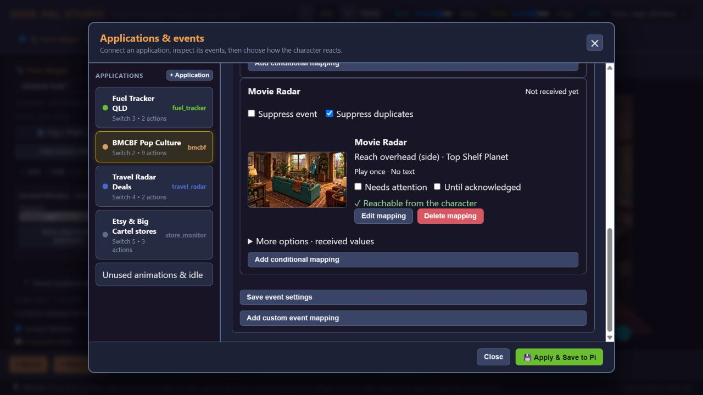

# Adding an application

For a worked application-side status/results contract and sample payloads, see [Build an application interface](producer-interface-example.md) and the comprehensive [Monitored applications guide](monitored-applications.md) with a runnable dummy application example (`examples/dummy_monitored_app.py`).

Desk-Pal monitors other software; it does not perform that application's work. Applications stay separate from Desk-Pal. Use **Applications → Add application** to enter a name and ID, or import an integration JSON definition. Neither importing a definition nor adding an application launches a producer script.


## Import a definition

Start with `examples/integration.example.json`. Change the application ID/name and describe the events and example payloads your application publishes. In the Add application form, choose **Import integration file**. This opens a preview before saving anything. Event names and examples populate **Events & mappings** after import. Example values are labeled as examples until real events arrive. New applications start with polling off, no hardware button and stopped-feed warnings off; configure their connection locally. URLs and credentials from a definition are not imported.

### Export and import reusable packages

Open **Backup / Restore → Export / import an integration** to export a saved application as version 1 JSON. The file contains declared events, anonymized example shapes, polling and suppression preferences, and reaction mappings. It excludes connection URLs, credentials, private adapter settings, button assignments, received payload values and custom speech templates. It contains no executable producer script; use the separate example sender below. Review application/event labels and conditions before sharing.

Choose a file and preview its destination ID. Use a new ID to add a copy, or explicitly confirm updating an existing application. By default only definitions/preferences are imported: existing action mappings remain. **Include scene / animation / location mappings** also replaces that application's action list. Preview shows event cards, scene thumbnails, preferences, conditions and playback settings. Missing or disabled scenes, missing gestures or placements and incompatible placement gestures block mapped imports. Import definitions alone to configure mappings visually afterward.

Replacing an application retains its local connection URL, credentials, relay adapter, adapter settings, health-warning choice and hardware assignment. Other applications, scenes and character libraries remain unchanged. Included actions use `{summary}` rather than transferring custom speech templates; redacted private conditions require local configuration. Polling/suppression preferences shown in the preview are imported. A private full recovery backup is saved before applying the confirmed import, and a failed save rolls settings back. A changed configuration invalidates the preview. Reload the editor after import and configure the connection and physical button. Save editor changes before opening the importer: it works from saved Pi settings.

Version 1 definitions contain `schema_version: 1`, an `application` object and an `events` array. Each event has `name`, optional `label`, and optional `example` JSON. Application settings include `source_url`, `source_enabled`, `poll_seconds`, `summary_field` and `monitor_health`. Definitions contain data, not executable code.

Each conditional mapping has **Delete mapping** beside **Edit mapping**, including while collapsed. Deletion asks for confirmation and identifies the settings being removed. Application/action deletion also requires confirmation; removing an integration does not delete the external application. Save to Pi applies editor changes.

Save the application, then select an event under **Events & mappings**. Compact cards show a scene/character preview, animation and location, playback mode, text setting and route status. **Suppress event** and **Suppress duplicates** are visible on the event card; each mapping has its own **Needs attention** and **Until acknowledged** controls. Click a preview or **Edit mapping** to open the visual scene picker on that same tab. Choose any placed animation, any matching location, or one specific saved placement. Message settings appear while editing; conditions are under **More options · conditions**, and raw payloads/counts under **More options · received values**. Add value conditions for distinctions such as a successful job or a cheap price. More specific conditions take precedence; one received event selects one matching action. The third tab, **Physical button**, controls the hardware button assignment and its status response.



Browsing and filtering do not change mappings. Checkbox edits remain local until **Save event settings**, **Save mapping**, or **Apply & Save to Pi**. Attention belongs to each mapping, so conditional variants can use different attention behavior. Expanding or toggling a card retains its scroll position. History downloads and the application ID are available under **History & application ID**.

## Send real updates

Event mappings can opt into **Until acknowledged** directly on the mapping card. The selected gesture repeats until the character is tapped or that application's physical button is pressed. That interaction stops the attention gesture and opens the original event's summary and details; dismiss the popup to continue queued reactions. The animation's saved playback default is unchanged. Routine button presses still use the application's normal button mapping. Other application buttons retain priority and an unacknowledged alert resumes afterward. Suppressing the event cancels its queued/active attention just like other reactions.

Each event row has **Suppress duplicates**. Named events default to suppressing unchanged payloads; heartbeats are exempt by default. Either can be changed with the checkbox and **Save event settings**. Suppressed updates still refresh health and appear in received counts/history. Transport freshness fields (`last_seen`, `received_at`, `polled_at`, `ttl_seconds`) do not make a new event. Include a genuine task/run ID or run timestamp to distinguish repeated work that returns the same result. If your producer cannot distinguish repeated tasks, disable suppression for that event.

Copy `examples/send_example.py` into your application or import its `send()` function. It uses Python's standard library. Replace demo values with state from your application's API, logs or database. Call it with your Desk-Pal URL:

```text
python examples/send_example.py --deskpal http://YOUR-DESKPAL:7777 --event job_finished
python examples/send_example.py --deskpal http://YOUR-DESKPAL:7777 --payload your-real-state.json
```

These commands deliberately send example data when no payload file is supplied. The example is not started automatically.

Send status JSON to `/api/v1/heartbeat` and named events to `/api/v1/event`, always with the configured `app_id`. Use `summary` for human-readable status, `status` for health and `ttl_seconds` for freshness. An event also includes `event` and whichever fields you need for conditions. `/api/v1/alert` accepts attention messages. Different applications may send different fields; Desk-Pal records per-event samples so later heartbeats do not hide them.

Optionally include `button_summary` in a heartbeat for a concise, actionable physical-button response. Normal buttons use the latest cached heartbeat rather than the last named event; without this field they use its ordinary summary. Freshness is measured from that heartbeat, so a later event cannot make old status look fresh. Buttons do not initiate additional upstream API polling. Acknowledging a pending attention event still displays that event's original information. Long popups have Previous/Next pages and remain open until dismissed.

Alternatively, you can run lightweight producer scripts directly on the Raspberry Pi using Desk-Pal's built-in **[Companion Services Supervisor](companion-services.md)** (managed in Web Studio under **⚡ Companion Scripts**). A companion script runs locally on the Pi and can be added to the Application list with one click, polling its local loopback endpoint (e.g. `http://127.0.0.1:8095/status`).

For external services running on an auxiliary PC on your network, Desk-Pal's native background integration poller can poll their REST endpoints directly across your LAN, or you can use `src/satellite_runner.py` to relay events. Generic JSON is the default; adapters for this personal installation are optional. Scene/action edits do not restart source polling.

## Playback

For retrospective checks, click **Download activity history** in Applications & events. It includes recent received inputs, suppressed inputs, queued/started/arrived/completed reactions, route errors and idle choices with UTC timestamps. Turn records share an activity ID so requested and actual scenes/gestures can be compared. The local Pi history survives restarts and rotates at roughly 10 MB total; downloads include the newest 5000 records. This detailed history begins when the logging version is deployed, rather than reconstructing older runs.

Select **Unused animations & idle** below the application list to inspect saved placements without event or button mappings. Flexible mappings count as using all matching placements; expand Mapped locations to see their applications. **Use while idle / no events** changes the existing idle eligibility for the active character's animation across its valid scenes. Idle and sleep checkboxes save immediately. Animations mapped to application events or buttons are reserved for those reactions and excluded from idle across all scenes, even if their saved idle preference is enabled. Walking and transition-only sequences are excluded; seated/resting animations still require their entry and exit transitions.

Automatic application actions enter one FIFO in the order Desk-Pal receives them. Physical-button requests interrupt feed work and take priority; their popups stay until dismissed. Each turn includes travel, arrival and animation playback. Finite animations finish according to their saved playback. Application events are milestones: loop duration defaults to 0, which plays one complete loop/ping-pong cycle and then finishes even if no other event is waiting. A positive duration repeats the loop for the chosen time; it does not shorten once/repeat playback. Idle animation loops remain continuous. Attention alerts retain their interaction hold, and internet-outage warnings retain their configured acknowledgement/recovery policy. Idle behavior runs when the queue is empty. Editing and sleep pause playback, preserving remaining dwell time. **Refresh live status** shows the active turn, waiting count and any route error.

Each application has a **Normal update reaction**. By default it uses the status/button reaction quietly; received heartbeats therefore produce activity without repeatedly opening summary popups. Choose another action or disable this behavior in Connection. Unmapped named events also use the normal reaction when one is configured. Specific events and attention mappings retain their own display choices. Pacing can be tuned after reviewing the queue.

The personal store entry is supplied by the independent [store monitor](../integrations/store-monitor/README.md). Etsy is connected on this installation; Big Cartel remains unconnected. The generic example includes no store credentials or queries.

The optional personal BMCBF adapter uses its configured `companion_state_path` and the adjacent application-root `bot.log` plus two rotated logs for a today summary. It reads existing results only: latest email outcome, observed summary deliveries, successful posts per platform, scraper completions and error source/time. Raw log bodies and email contents are not sent. Counts are explicitly limited to available log coverage; absence of a recorded success is not a claim that a task never ran. This adapter does not import BMCBF code or start its tasks. A structured producer results API would be preferable long term.

When preparing a public repository, publish clean example definitions and sender instructions, not live application settings, telemetry, snapshots or credentials. The external applications themselves are not part of Desk-Pal.

## Sleep button

In **Unused animations & idle**, use **Use for sleep button** beside an animation ; checkbox changes save immediately. Sleep shares the idle progression cursor and picks the next reachable sleep-enabled saved placement across connected enabled scenes, skipping other poses. Sleeping, sitting against a support, seated-back and deck-chair rest are enabled by default; animations with transitions need both entry and exit sequences. With no reachable eligible placement across connected scenes, standby holds in place and still powers off the display. Wake gets up from the same rest placement before resuming application work.

During standby, routine updates coalesce to the latest per application/event. On wake, routine work older than the application’s configured age limit is discarded (default 900 seconds; 0 disables expiry). Important alerts and physical-button actions are retained. An interrupted active reaction is deferred before this policy is applied. Sleep/wake choices and discarded work appear in activity history.

## Suppression and health

Each event has **Suppress duplicates** and **Suppress event**. The first skips unchanged successive payloads (heartbeats default exempt). The second skips reactions while continuing to receive and log state and refresh health. It removes matching pending/active reactions, but does not disable physical buttons or source polling. Use **Save event settings**. Heartbeat headings are consistently named **Heartbeat**.

Feed health depends on received timestamps, not whether its animation played. Stopped-feed warnings clear on recovery; short polling delays get a grace period. A reachable source can still expose stale task history, so compare its task timestamps as well as its heartbeat freshness.

Idle playback progresses through eligible placements and open-floor poses across connected enabled scenes after an event completes. It waits with that pose until another event arrives, rather than repeatedly choosing a new pose on a timer. Finite idle animations hold their final frame; loops continue. Event playback modes and per-location overrides remain independent.

## Optional agent reporting is documented separately

This guide describes Desk-Pal's normal application monitoring interfaces. LLM agents can optionally publish task phases through a separate MCP adapter, but no agent or MCP setup is required for these interfaces. See [Optional LLM agent activity](agent-activity.md) for its purpose and limits, then the [adapter setup guide](../integrations/agent-mcp/README.md) if wanted. Existing mappings and queue behaviour are shared; a display acknowledgement never grants permission to the agent.
