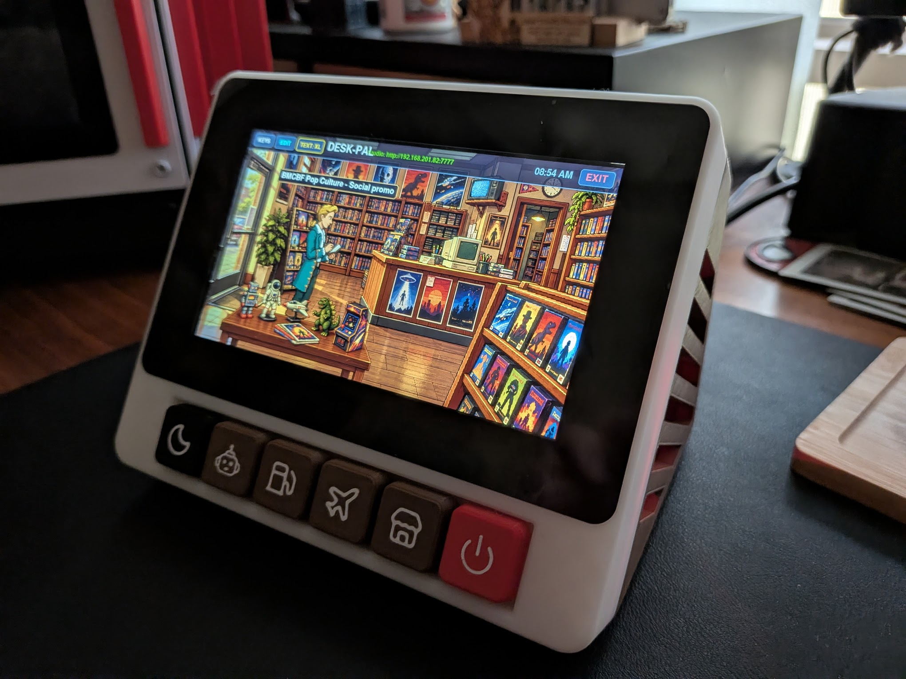

# Hardware, wiring and printed parts

The current Desk-Pal is a Raspberry Pi 4 Model B with a 5-inch touchscreen and six MX-style mechanical switches: five brown tactile switches and a red shutdown switch. It runs Raspberry Pi OS with a working graphical session. The scene canvas is 1280×720 and may be scaled to the panel's native resolution.

## Components and tools

- Raspberry Pi 4 or newer; the current build runs on a Pi 4. Match enclosure mounting and display cabling to your chosen Pi.
- Official **Raspberry Pi 5-inch Touch Display 2**. Follow the [official display connection guide](https://www.raspberrypi.com/documentation/accessories/touch-display-2.html).
- Six Cherry MX-style mechanical switches and six matching keycaps. The current switch selection is five brown tactile switches plus one red shutdown switch. The switch is the electrical component; the keycap fits onto its stem.
- Printed enclosure and keycaps from the links below. This build used the generator's low-profile keycap option with tolerance adjustment.
- Wire, an eight-position header connector/wire harness, and crimp contacts for that harness.
- Lever/snap connectors for branching the shared grounds; the build notes identify Wago 3-port and 5-port connectors.
- Soldering iron, solder, wire cutters/strippers and a suitable crimping tool.

The switch terminals in this build were soldered; crimp connectors did not fit them. Keycaps themselves have no electrical connections. Use the crimped/header harness and ground distribution connectors where suitable, with soldered leads at the switches.

Power-supply model, connector pitch/type, fasteners and detailed print settings still need recording.

## Button wiring

This table follows the current application/configuration assignment, ordered left to right. One contact of each switch connects to the signal pin below; the other connects to shared ground. GPIO inputs use pull-ups and debounce through gpiozero. Use ground, not a supply voltage, for the return contacts.

| Position | Switch | Physical header pin | BCM GPIO | Current function |
| --- | --- | --- | --- | --- |
| 1 | Brown | 37 | 26 | Sleep / wake display |
| 2 | Brown | 35 | 19 | BMCBF cached status |
| 3 | Brown | 33 | 13 | Fuel cached status |
| 4 | Brown | 31 | 6 | Travel cached status |
| 5 | Brown | 29 | 5 | Stores cached status |
| 6 | Red | 27 | 0 | Shutdown |

Application/button assignments are configurable. Sleep and shutdown are system controls. The signal table replaces an older README diagram whose switch numbering contradicted the current layout.

Original build notes describe a Wago 3-port ground distribution for switches 1–2 from physical ground pin 39, and a Wago 5-port distribution for switches 3–6 from physical ground pin 25. Both grounds are common on the Pi; verify the enclosure wiring before reproducing the build.

BCM 0 on physical pin 27 is also the HAT identification line (ID_SD); this particular build uses it for shutdown. Check compatibility if adding a HAT or changing the Pi model. Do not assume this pin choice applies to every build.

## Eight-position connector orientation

**USB end inward: physical pins 39 → 25.** Connector pin 1 is closest to the USB edge, with pin 8 furthest inward. This harness uses one side of the Pi's 40-pin header; do not confuse connector positions, physical header pins and BCM GPIO numbers.

| 1×8 connector position | Pi physical pin | BCM GPIO | Connection |
| --- | --- | --- | --- |
| 1 — closest to USB edge | 39 | GND | Ground 1 |
| 2 | 37 | 26 | Switch 1 |
| 3 | 35 | 19 | Switch 2 |
| 4 | 33 | 13 | Switch 3 |
| 5 | 31 | 6 | Switch 4 |
| 6 | 29 | 5 | Switch 5 |
| 7 | 27 | 0 / ID_SD | Switch 6 |
| 8 — furthest inward | 25 | GND | Ground 2 |

The supplied build table's GPIO 24/23/22/21 labels have been corrected to BCM 19/13/6/5. Physical pin positions are unchanged and match the running application. For an on-device reference, run `pinout`; see [Raspberry Pi hardware documentation](https://www.raspberrypi.com/documentation/computers/raspberry-pi.html).

## Display and power

See [Hardware live view and calibration](hardware-testing.md) for optional sensor/audio wiring, the revised display power connector, hands-free IMU calibration, radar movement capture and light-controlled sleep. Light sleep/wake and calibrated tilt reactions have been physically confirmed; USB speaker output is also physically confirmed. The Hardware page provides saved speaker selection and volume slider, saved microphone wake peak threshold (`300–30000`) with live `dBFS`/peak telemetry, angled-mount IMU calibration, and configurable BCM button assignments with test mode. Radar position accuracy remains unverified. Reader enable switches and animation mappings are separate settings.

The sleep button powers off the display after the character reaches its rest placement; it does not halt the Pi or stop monitoring. Touch/buttons remain available for wake. The current driver's power/brightness handling is documented in [Idle and standby](idle-and-standby.md).

Shutdown is separate from display standby. Use the shutdown control before removing Pi power. The installed display and sensor wiring are described in the linked diagnostic guide; remaining reproduction details include the exact power supply and an internal wiring photograph.

The supplied display/enclosure/sensor-holder links are recorded here and in the diagnostic guide. An internal wiring photo, exact power supply and any further connector/print details remain to be recorded; those gaps do not mean the already connected sensors are still unimplemented.

## Printed parts and model credits

Add the original model links, even when a part was modified. Include the designer, licence, version/remix relationship and changes required for this hardware.

| Part | Original model / designer | Licence | Build notes |
| --- | --- | --- | --- |
| Complete enclosure with buttons | [Case for Raspberry Pi 5 Touch Display 2 with buttons](https://makerworld.com/en/models/2418768-case-for-raspberry-pi-5-touch-display-2-w-buttons#profileId-2652559) | Confirm on model page | Contains the components; check the chosen Pi's fit |
| Custom printed keycaps | [MakerLab keycap legend generator](https://makerworld.com/en/makerlab/community/keycap-legend/edit) | Confirm generator/output terms | Low-profile option used; adjust tolerance for the switch stems |
| Sensor holders: BH1750, MPU-6050 and RD-03D | [Builder’s sensor mounts](https://makerworld.com/en/models/3423200-rpi-5-touch-case-h1750-mpu-6050-rd-03d-mounts) | Confirm on model page | Used in the current enclosure; secure fit with slide-out removal for disassembly |
| Any additional printed parts/remixes | Add if applicable | To confirm | Record only parts actually used |

The model links were supplied by the builder. Designer names and licence details have not yet been verified; record them from the source pages before redistributing model files. Record filament/material, layer height, supports, fasteners and any dimensional changes alongside the relevant part when available. The assembled unit is pictured above. An internal wiring photograph would further help reproduce the build.
