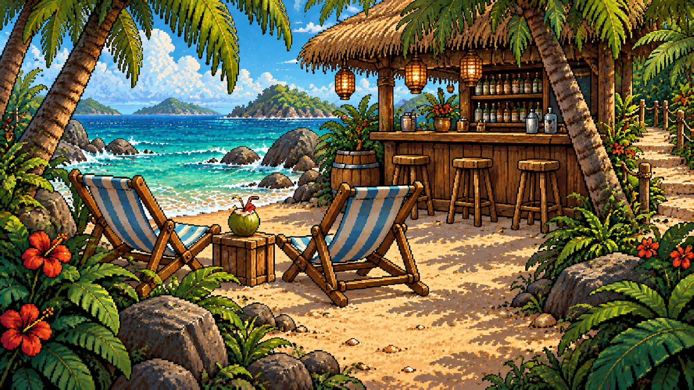
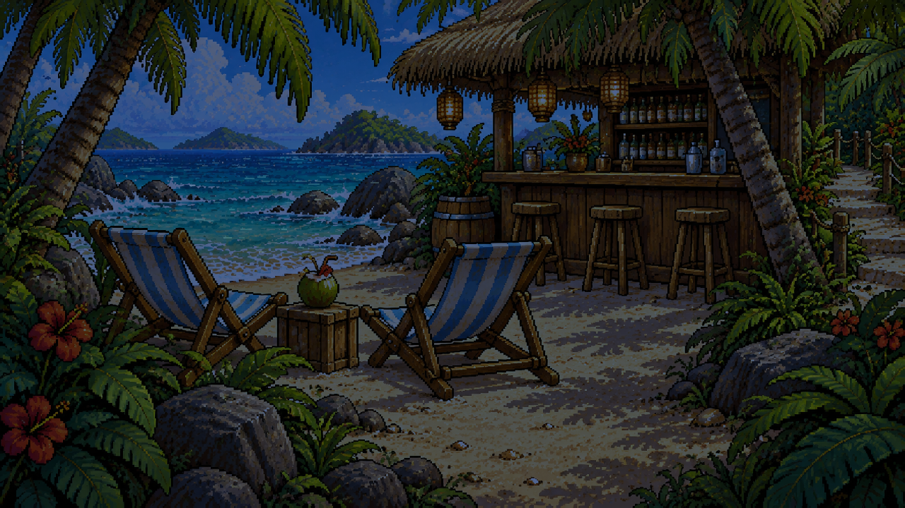
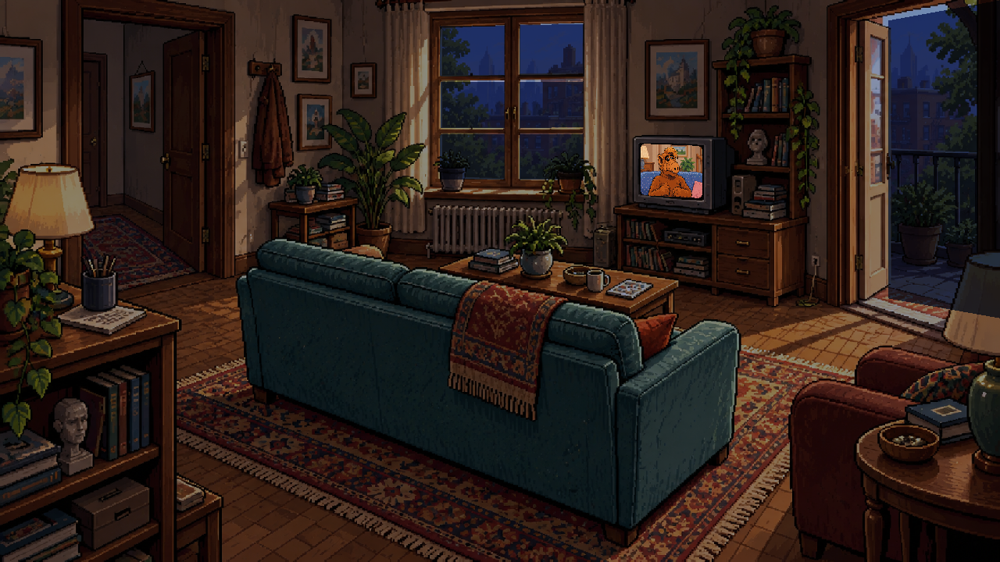
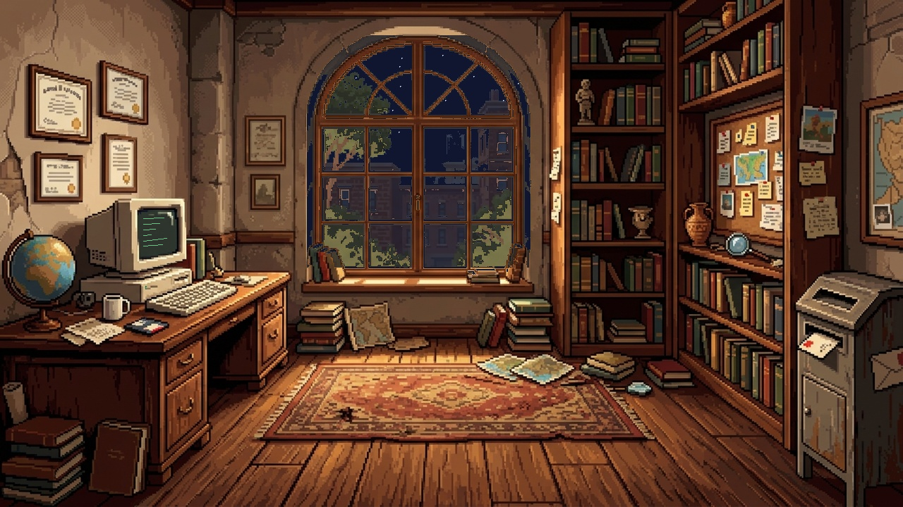

# Image props

## Build a prop

Open **Animation Grid → Props → New prop**. Upload one or more PNG images. Transparent PNGs work best; use the same canvas dimensions and alignment for every animation frame.

Uploads are sorted by filename, using numeric ordering. Use the frame arrows to adjust the order, or Remove to remove a frame from the sequence. The preview supports Play/Pause and Restart. Choose FPS and once, repeat, loop or ping-pong playback. One-frame sequences are still images. Once and repeat hold their final frame when finished.

Save the library to Pi. Prop sequences are independent of characters. A library entry can only be deleted when it has no placements in any scene. Removing entries or frames does not delete uploaded files.

## Place a prop

Enable **View props**, choose a library item and click **Add prop**. It appears in the centre of the current scene. Drag the image to position it; its square handle changes size and its round handle rotates it. Numeric controls provide precise adjustments. Placements share library frames but have independent transforms and triggers.

Use Play/Pause and Restart while positioning. Preview playback ignores triggers so you can see the animation without sending an application event. Save props to Pi when finished.

Layers are Behind character, In front, or By depth. By depth compares the placement's ground-depth Y with the character's feet Y. Ground depth is independently adjustable; it is not the image's centre. Image props do not create collision footprints automatically. Use blocks/foreground objects for collision and more complex angled occlusion.

Playback triggers:

- Always: plays while the scene is active and the character is awake.
- Typing here: plays when the character has reached the selected typing location.
- Pose at location: plays after arrival at the selected placement while the selected character animation is playing. Sitting transitions, travel and standby do not activate it.
- Application action: plays while an active application prop overlay targets this placement, using the action's existing overlay target and duration controls.

Inactive props show their first frame unless **Hide when inactive** is checked. Expand **Animation choices** to select multiple library animations: the Pi randomly chooses one each time the placement activates, then keeps that choice until the trigger stops. The editor cycles choices every eight seconds for preview.

For a television or other angled screen, select **Fit to screen / regular image**, then drag the four purple corners to the screen edges. Screen projection changes the prop placement rather than the character or scene geometry.

Included scene props demonstrate pose-linked playback and tappable Easter egg interactions. You can replace their frames and animation choices with your own. In Web Studio under **View props**, all placed scene props now appear in the selector with clear tags (`[📺 TV Easter Egg]`, `[🖥️ Screen]`, or `[🖼️ Prop]`), and switching scenes automatically refreshes the placed props list. When a TV Easter egg is selected, its interactive configuration and channel selectors are explicitly highlighted. The procedural monitor remains available under **Built-in monitor prop**, with four-corner positioning and a typing-location link.

## Implementation and verification

Library: `config.prop_animations`. Scene-local placements: `props[].animation_id`, `x`, `y`, `width`, `rotation`, `layer`, `depth_y`, `trigger`, optional `typing_spot_id`. Upload endpoint: `/api/props/frame`; assets: `/assets/props/<id>.png`.

`src/prop_editor.js` is the maintained prop-editor source, embedded into `src/web_studio.html` for the existing single-file editor delivery. Keep the embedded copy synchronized after edits. Runtime renderer and validation: `src/prop_runtime.py`.

Checks: `scripts/test_prop_editor.cjs`, `scripts/test_prop_runtime.py`, `scripts/test_prop_render.py`. Rendering was verified headlessly with pygame on the Pi. Upload/static serving was verified byte-for-byte, including alpha. The apartment TV’s pose gating, random choice persistence, off state and projection were tested with real assets on the Pi without injecting feed events.

## Beach water

The resort beach includes **Ocean ripples**, using the **Beach water ripples** library sequence: 12 original transparent pixel-art frames at 4 FPS. It plays behind the character while awake and hides during standby. Only exposed water patches are drawn, leaving the scene artwork intact.

Use **View props** in the beach scene to select the placement, pause/restart it, or disable it. Its full-scene transparent canvas is aligned at X 640, Y 360, width 1280; moving/scaling it changes the alignment of the water patches. Animation Grid → Props allows FPS/playback changes. Existing masks, floors, blocks, pose locations and mappings were preserved during installation.

Frames can be regenerated with `scripts/build_beach_water.py`; `scripts/install_beach_water.py` refuses to replace an existing saved water sequence. `scripts/verify_beach_water.py` checks the installed frames through the Pi renderer without restarting the live display, verifies movement and standby hiding, and saves a preview.

### Night rendering review — 4 October 2026

Headless rendering on the running Pi verified the beach ripple sequence against the beach's night tint, the apartment couch TV against its derived night background, and the study typing monitor against its saved night artwork. Water highlights remain subtle; TV artwork and green monitor text remain illuminated because props draw after background lighting. No brightness adjustment was needed. This was an isolated render check, not a change to the live solar clock, scenes or mappings; temporary remote preview files were removed.

For another installation, run `python scripts/install_beach_water.py --url http://YOUR-PI:7777`. It uses the editor API and no SSH credentials. The headless Pi verification helper is personal tooling and excluded from publication.

